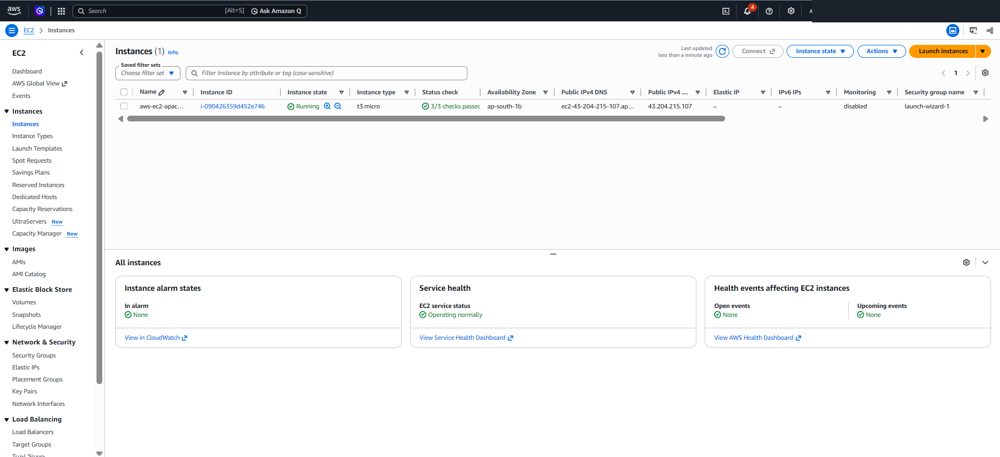
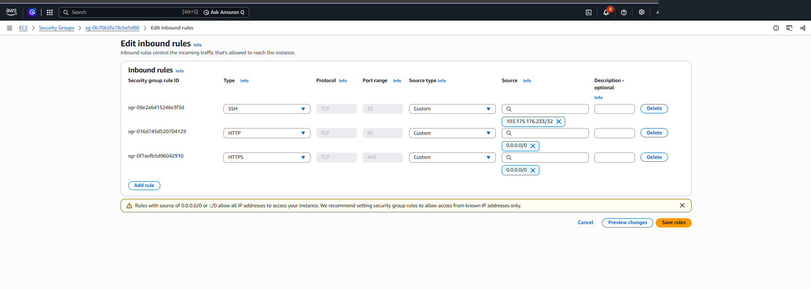
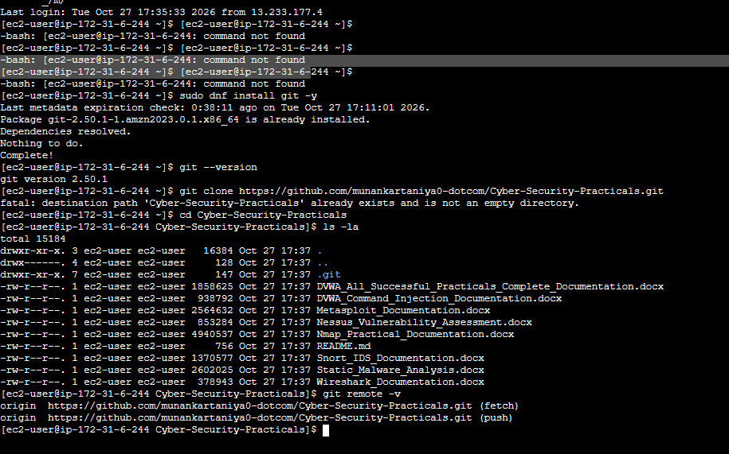
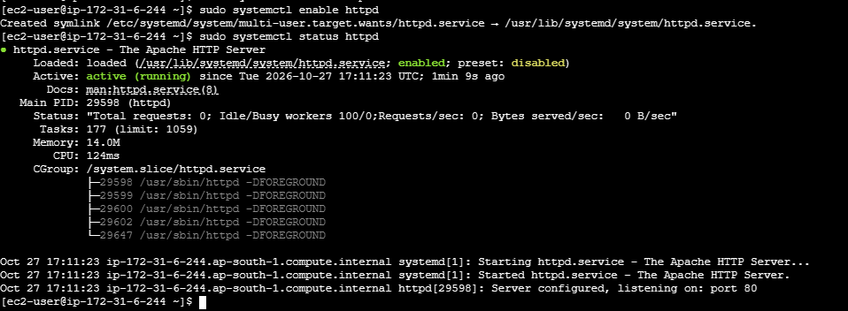
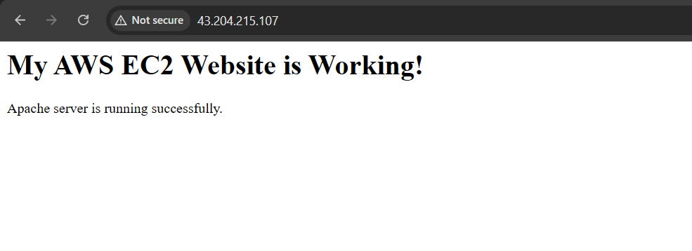

# AWS Cloud Infrastructure: EC2 Web Server Deployment & Linux Administration

> A student practical demonstrating GitHub-based documentation, Amazon EC2, Amazon Linux 2023, Security Groups, SSH access, Apache, and a live HTTP website.

## Table of Contents
- [Project Overview](#project-overview)
- [Objectives](#objectives)
- [Tools and Technologies](#tools-and-technologies)
- [Architecture and Workflow](#architecture-and-workflow)
- [Deployment Steps](#deployment-steps)
- [Evidence Screenshots](#evidence-screenshots)
- [Repository Contents](#repository-contents)
- [Security Notes](#security-notes)
- [Conclusion](#conclusion)

## Project Overview

This practical demonstrates launching a Linux virtual machine on AWS EC2, allowing required network traffic through a Security Group, connecting with EC2 Instance Connect, installing Apache HTTP Server, and publishing a basic HTML page through the instance's public IPv4 address.

The GitHub repository also contains documentation for cybersecurity practicals such as Nmap, Nessus, Metasploit, Wireshark, Snort, static malware analysis, and DVWA.

## Objectives

- Launch and inspect an EC2 Linux instance.
- Understand Security Group inbound rules.
- Connect to a Linux instance using EC2 Instance Connect.
- Install and start Apache HTTP Server.
- Deploy a basic HTML page to Apache's document root.
- Verify the website in a browser.
- Document the process and evidence in GitHub.

## Tools and Technologies

- Amazon Web Services (AWS)
- Amazon EC2
- Amazon Linux 2023
- EC2 Instance Connect
- Apache HTTP Server (`httpd`)
- Linux shell commands
- Git and GitHub
- Web browser

## Architecture and Workflow

```text
GitHub repository
       |
       | Review documentation / clone repository
       v
AWS EC2 instance (Amazon Linux 2023)
       |
       | Security Group: HTTP TCP/80
       v
Apache HTTP Server (httpd)
       |
       v
Browser -> http://<EC2-Public-IPv4>
```

## Deployment Steps

### 1. Check the EC2 instance

In the AWS Console, open **EC2 → Instances**. Confirm the instance state is **Running** and status checks have passed.

To connect, select the instance and choose **Connect → EC2 Instance Connect**. The demonstrated Amazon Linux default username is `ec2-user`.

### 2. Configure the Security Group

The practical used the following required inbound access:

| Type | Protocol | Port | Recommended source |
|---|---|---:|---|
| SSH | TCP | 22 | My IP / trusted administrator IP |
| HTTP | TCP | 80 | `0.0.0.0/0` for a public demo website |

Only add HTTPS on TCP/443 if TLS/HTTPS has actually been configured. Do not open SSH to everyone for convenience. The screenshot evidence may show rules from intermediate setup stages; use the secure recommendations in this table for the final configuration.

### 3. Verify the Linux session

Run commands individually in the EC2 terminal. Do not type the terminal prompt itself (for example, `[ec2-user@ip-... ~]$`); type only the command after the `$`.

```bash
whoami
git --version
```

The expected user for this instance is `ec2-user`. Git was installed/available in the demonstrated environment.

### 4. Clone the GitHub repository

The repository was cloned successfully, and the terminal showed the repository files and remote URL. If the directory already exists, do not clone into the same non-empty directory again. Instead:

```bash
cd ~/Cyber-Security-Practicals
git remote -v
git pull origin main
```

To clone it for the first time in a fresh location:

```bash
git clone https://github.com/munankartaniya0-dotcom/Cyber-Security-Practicals.git
cd Cyber-Security-Practicals
```

### 5. Install Apache on Amazon Linux 2023

```bash
sudo dnf update -y
sudo dnf install httpd -y
sudo systemctl enable --now httpd
sudo systemctl status httpd
```

The service status should show `active (running)`. In the recorded terminal session, Apache was successfully started.

### 6. Create a simple web page

Create the file in Apache's web root:

```bash
sudo tee /var/www/html/index.html > /dev/null <<'EOF'
<!doctype html>
<html lang="en">
<head>
  <meta charset="utf-8">
  <meta name="viewport" content="width=device-width, initial-scale=1">
  <title>Cyber Security Practicals</title>
</head>
<body>
  <h1>My AWS EC2 Website is Working!</h1>
  <p>Apache server is running successfully.</p>
  <p>Project: Cyber-Security-Practicals</p>
  <p><a href="https://github.com/munankartaniya0-dotcom/Cyber-Security-Practicals">View GitHub repository</a></p>
</body>
</html>
EOF

sudo systemctl restart httpd
```

### 7. Verify the website

Open this address in a browser, replacing the placeholder with the instance's current public IPv4 address:

```text
http://<EC2-Public-IPv4>
```

The recorded evidence shows the page title **“My AWS EC2 Website is Working!”** and the message **“Apache server is running successfully.”**

If the page does not load, check that:
- The instance is running.
- Apache is active: `sudo systemctl status httpd`
- The Security Group permits inbound TCP port 80.
- The address is the current public IPv4 address.
- The subnet/network configuration permits internet traffic.

## Evidence Screenshots

Screenshots below were captured during the practical workflow. Some show intermediate configuration states; use the deployment steps above as the final reference.

### 1. GitHub repository


### 2. EC2 instance details


### 3. Security Group inbound rules


### 4. EC2 terminal and Git repository


### 5. Apache service running


### 6. Live website output in browser

**Observed output:** `My AWS EC2 Website is Working!`  
**Confirmation message:** `Apache server is running successfully.`  
**URL shown in the practical screenshot:** `http://43.204.215.107`



## Repository Contents

The GitHub repository contains documentation files for multiple cybersecurity practicals, including:

- DVWA command injection
- Metasploit
- Nessus vulnerability assessment
- Nmap network scanning
- Snort IDS
- Static malware analysis
- Wireshark

Repository: [Cyber-Security-Practicals](https://github.com/munankartaniya0-dotcom/Cyber-Security-Practicals)

## Security Notes

- Never commit AWS access keys, passwords, private SSH keys, tokens, or other credentials.
- Restrict SSH (TCP/22) to your own trusted IP address.
- A public HTTP website is not encrypted. Use HTTPS only after configuring a valid TLS certificate and HTTPS server settings.
- EC2 public IPv4 addresses can change when an instance is stopped and started unless an Elastic IP is assigned.
- Stop or terminate resources when no longer required, and check AWS billing to avoid unexpected charges.

## Conclusion

This practical demonstrates a basic cloud deployment workflow: provision an EC2 Linux instance, configure network access, connect to the server, install Apache, deploy HTML content, verify the live website, and document the evidence in GitHub.

---
**Student practical note:** Update this README if your final AWS configuration differs from the screenshots. Only claim steps you personally completed and verified.
